# Comparative Implementation of Machine Learning Regression Algorithms

[](https://colab.research.google.com/github/Afnan-makstrix/comparative-machine-learning-regression/blob/main/comparative_ml_regression_colab.ipynb)

## Academic Assignment: Handwritten + Programming Evaluation

**Course:** Machine Learning / Artificial Intelligence  
**Degree Program:** Bachelor of Science in Artificial Intelligence (BS AI)  
**Author:** Muhammad Afnan  
**Dataset:** California Housing Dataset (Scikit-Learn)  
**Target Variable:** `MedHouseVal` (Median House Value in $100,000s)  

---

## 1. Project Overview

This repository contains an end-to-end comparative machine learning regression benchmark evaluating six classical and modern supervised regression algorithms on the standard **California Housing Dataset**. 

The goal of this study is to empirically evaluate how differing structural assumptions, inductive biases, and optimization techniques influence predictive precision, generalization capability, computational latency, and interpretability.

### Notebook Options:
- **[comparative_ml_regression_colab.ipynb](comparative_ml_regression_colab.ipynb):** Clean, runnable Google Colab notebook with **zero comments in code cells** and **14 analytical and diagnostic graphs**.
- **[comparative_ml_regression.ipynb](comparative_ml_regression.ipynb):** Standard academic notebook with inline explanations and complete markdown sections.
- **[experiment.py](experiment.py):** Standalone Python script for headless reproduction.

### Implemented Algorithms:
1. **Linear Regression (Ordinary Least Squares)**
2. **Decision Tree Regression**
3. **Random Forest Regression (Ensemble Bagging)**
4. **Neural Network Regression (Multi-Layer Perceptron - MLPRegressor)**
5. **XGBoost Regression (Extreme Gradient Boosting - XGBRegressor)**
6. **K-Nearest Neighbors Regression (KNeighborsRegressor)**

---

## 2. Dataset Description

The California Housing dataset is loaded via `sklearn.datasets.fetch_california_housing(as_frame=True)`. It contains data derived from the 1990 U.S. Census across California block groups.

- **Sample Size:** 20,640 records
- **Feature Space:** 8 continuous numeric predictors
  - `MedInc`: Median income in block group (in $10,000s)
  - `HouseAge`: Median house age in block group (years)
  - `AveRooms`: Average number of rooms per household
  - `AveBedrms`: Average number of bedrooms per household
  - `Population`: Block group population
  - `AveOccup`: Average number of household members
  - `Latitude`: Block group latitude coordinate
  - `Longitude`: Block group longitude coordinate
- **Target Variable:** `MedHouseVal` (Median house value expressed in units of $100,000, range 0.15 to 5.00). Note that values at 5.00 are artificially capped in the census collection process.
- **Data Quality:** 0 missing values, 0 duplicate records.

---

## 3. Methodological Design and Data Preprocessing

### 3.1 Train-Test Partitioning
- Complete dataset (20,640 records) is partitioned into:
  - **Training Subset:** 80% (16,512 samples)
  - **Testing Subset:** 20% (4,128 samples)
- Deterministic random seed `random_state=42` is enforced throughout to ensure 100% reproducible splits across all models.

### 3.2 Prevention of Data Leakage
To prevent optimistic bias and test contamination, `StandardScaler` is fitted **strictly on the training data (`X_train`)**:
```python
scaler = StandardScaler()
X_train_scaled = scaler.fit_transform(X_train)
X_test_scaled = scaler.transform(X_test)
```

### 3.3 Selective Feature Scaling Strategy
Algorithms make different mathematical assumptions regarding input scale:
- **Scaled Features Applied To:**
  - *Linear Regression:* Prevents ill-conditioned matrix inversion and coefficient distortion.
  - *Neural Network (MLPRegressor):* Required for well-conditioned gradient backpropagation and uniform weight updates across dimensions.
  - *K-Nearest Neighbors:* Imperative because Euclidean distance $d(x, x') = \sqrt{\sum (x_j - x'_j)^2}$ is directly corrupted by features with wide numerical spans.
- **Original Unscaled Features Applied To:**
  - *Decision Tree Regressor*
  - *Random Forest Regressor*
  - *XGBoost Regressor*  
  Tree splits evaluate threshold candidates per single variable monotonically. Any monotonic transformation leaves split rank order and variance reduction invariant.

---

## 4. Hyperparameter Configurations

All six models were initialized with the following configurations:

| Model | Hyperparameter Configuration | Input Scale |
| :--- | :--- | :--- |
| **Linear Regression** | `LinearRegression()` | Standardized |
| **Decision Tree** | `DecisionTreeRegressor(random_state=42, max_depth=10)` | Original |
| **Random Forest** | `RandomForestRegressor(n_estimators=100, random_state=42, n_jobs=-1)` | Original |
| **Neural Network (MLP)** | `MLPRegressor(hidden_layer_sizes=(64, 32), max_iter=500, early_stopping=True, random_state=42)` | Standardized |
| **XGBoost** | `XGBRegressor(n_estimators=100, max_depth=6, learning_rate=0.1, objective="reg:squarederror", random_state=42)` | Original |
| **KNN** | `KNeighborsRegressor(n_neighbors=5)` | Standardized |

---

## 5. Experimental Results and Comparative Performance Table

The models were evaluated on the 4,128 held-out test records using standard Scikit-Learn metrics:
- **MAE:** Mean Absolute Error
- **MSE:** Mean Squared Error
- **RMSE:** Root Mean Squared Error
- **R² Score:** Coefficient of Determination ($1 - SS_{res}/SS_{tot}$)
- **Train Time:** Elapsed fitting wall-clock time in seconds
- **Pred Time:** Elapsed test inference wall-clock time in seconds

The table below is sorted by ascending **RMSE** (lowest error to highest error):

| Algorithm | MAE | MSE | RMSE | R² Score | Train Time (s) | Pred Time (s) |
| :--- | :---: | :---: | :---: | :---: | :---: | :---: |
| **XGBoost** | **0.3155** | **0.2273** | **0.4767** | **0.8266** | 0.1033 | 0.0037 |
| **Random Forest** | 0.3277 | 0.2560 | 0.5060 | 0.8046 | 1.0594 | 0.0412 |
| **Neural Network (MLP)** | 0.3533 | 0.2745 | 0.5239 | 0.7905 | 3.0967 | 0.0081 |
| **Decision Tree** | 0.4335 | 0.4165 | 0.6454 | 0.6822 | 0.0665 | 0.0000 |
| **KNN** | 0.4462 | 0.4324 | 0.6576 | 0.6700 | 0.0120 | 0.1042 |
| **Linear Regression** | 0.5332 | 0.5559 | 0.7456 | 0.5758 | 0.0165 | 0.0000 |

*Note: All metric values are rounded to 4 decimal places.*

---

## 6. Comprehensive Visualizations (14 Diagnostic Graphs)

All visualization figures are stored in the `figures/` directory:

### 6.1 Geographical Map & Spatial Distribution
Mapping census blocks across California with bubble colors indicating median house values and bubble sizes reflecting block population:
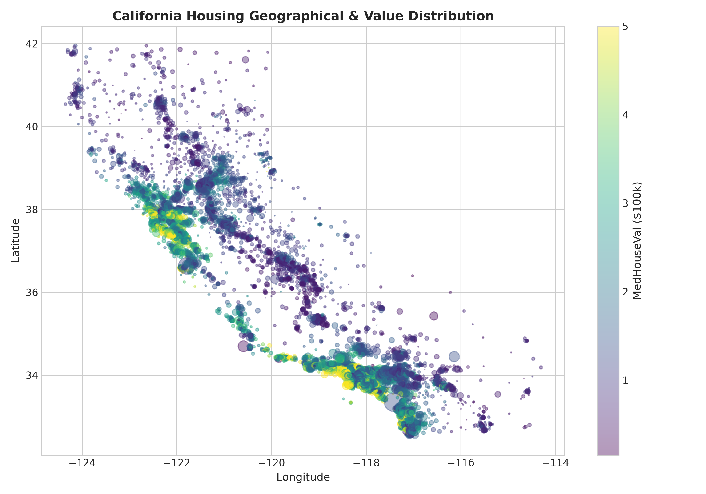

### 6.2 Feature & Target Distributions
Histograms with Kernel Density Estimation (KDE) overlays for all predictors and the target variable:
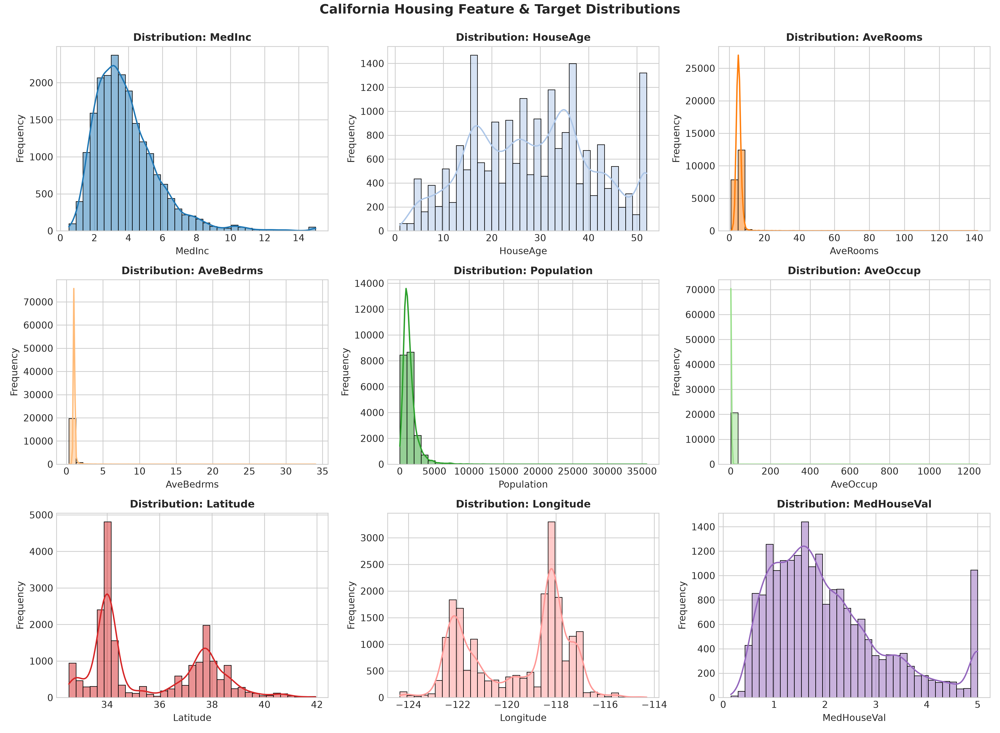

### 6.3 Pearson Correlation Matrix Heatmap
Pairwise linear correlation across all features:
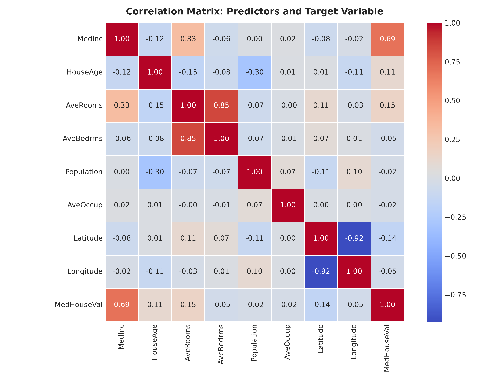

### 6.4 Key Predictors vs. Target Value Relationships
Bivariate scatter plots with linear trendlines for the top four predictors (`MedInc`, `HouseAge`, `AveRooms`, `AveOccup`):
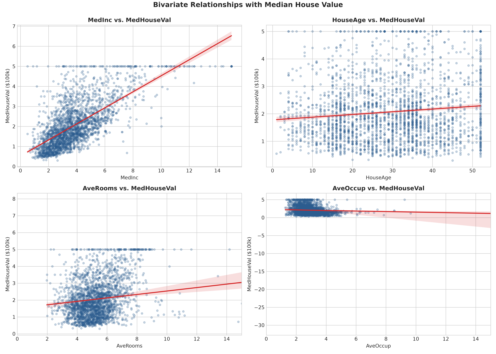

### 6.5 Actual vs. Predicted Scatter Plots (2x3 Layout)
Scatter plots displaying ground-truth housing values versus predictions for all six algorithms, overlaid with a dashed red diagonal line ($y = x$) representing perfect theoretical estimation:
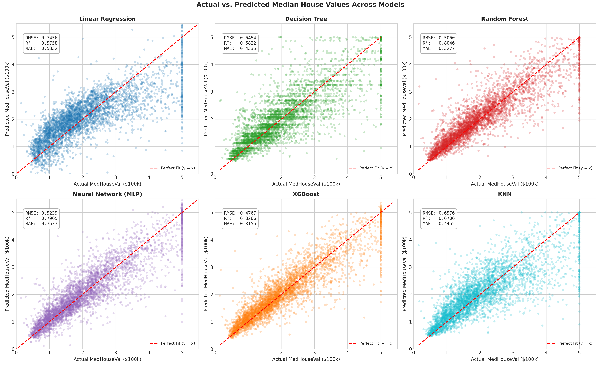

### 6.6 Residuals vs. Predicted Values (Homoscedasticity Diagnostic)
Plotting residuals ($y - \hat{y}$) against predicted values $\hat{y}$ to detect heteroscedasticity or systematic non-linear error patterns across models:
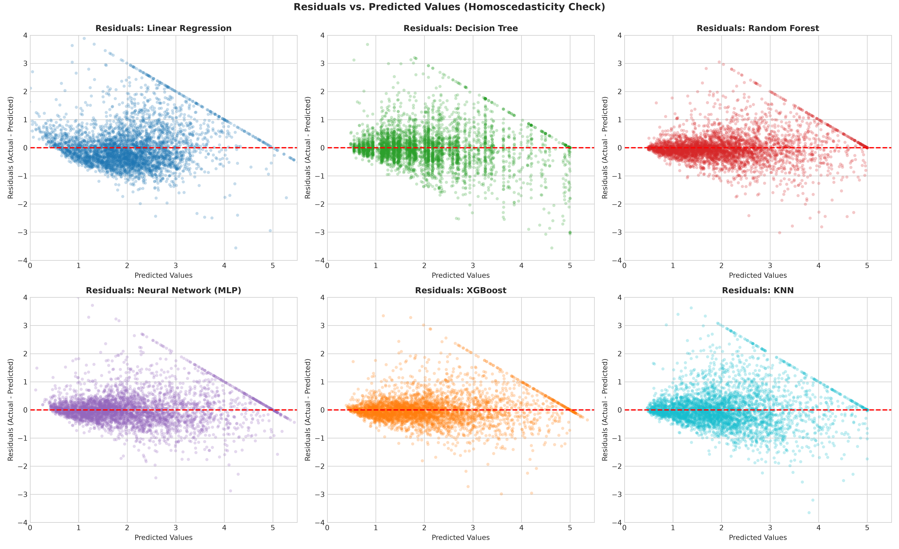

### 6.7 Residual Error Distribution Histograms
Assessing the zero-mean normality of prediction residuals across all six algorithms:
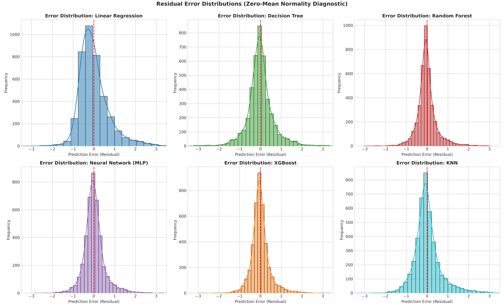

### 6.8 RMSE Comparison Across Models
Bar chart displaying the Root Mean Squared Error across all six models (lower is better):
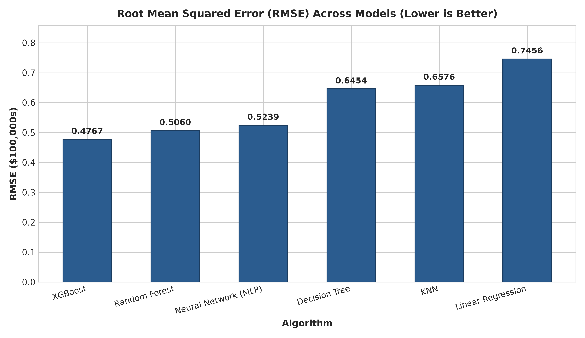

### 6.9 MAE Comparison Across Models
Bar chart displaying the Mean Absolute Error across all six models (lower is better):
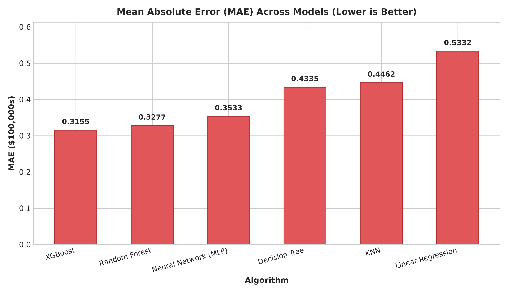

### 6.10 R² Score Comparison Across Models
Bar chart displaying the Coefficient of Determination across all six models (higher is better):
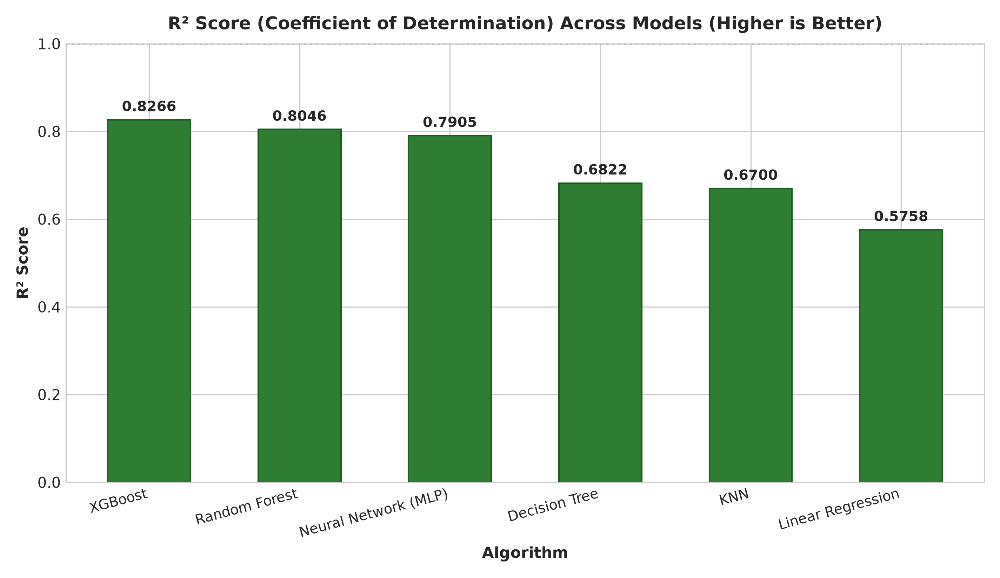

### 6.11 Multi-Metric Grouped Comparison
Direct side-by-side view comparing MAE, MSE, RMSE, and R² Score:
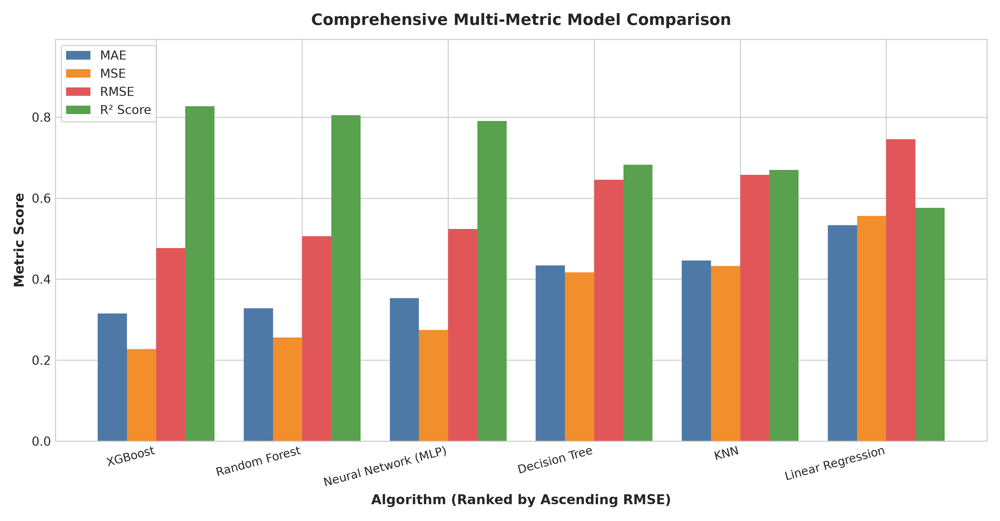

### 6.12 Computational Training & Inference Efficiency Comparison
Horizontal bar charts contrasting model fitting duration and test query latency:
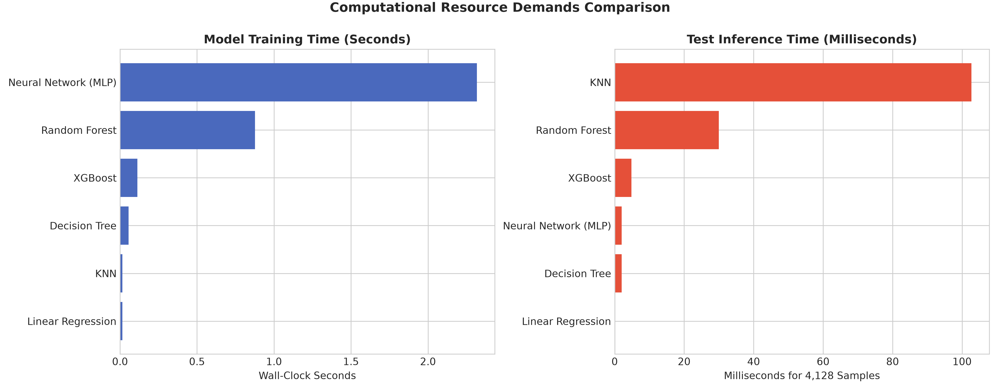

### 6.13 Feature Importance Across Model Paradigms
Comparing feature importance weights across XGBoost, Random Forest, and Linear Regression:
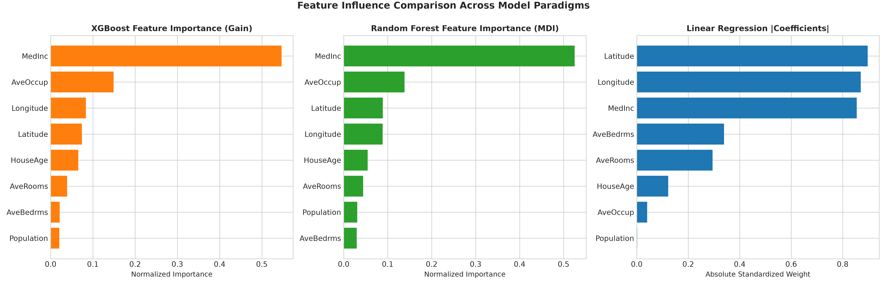

### 6.14 Empirical Cumulative Error Distribution (CDF)
Illustrating the proportion of test predictions falling within any given absolute error threshold:
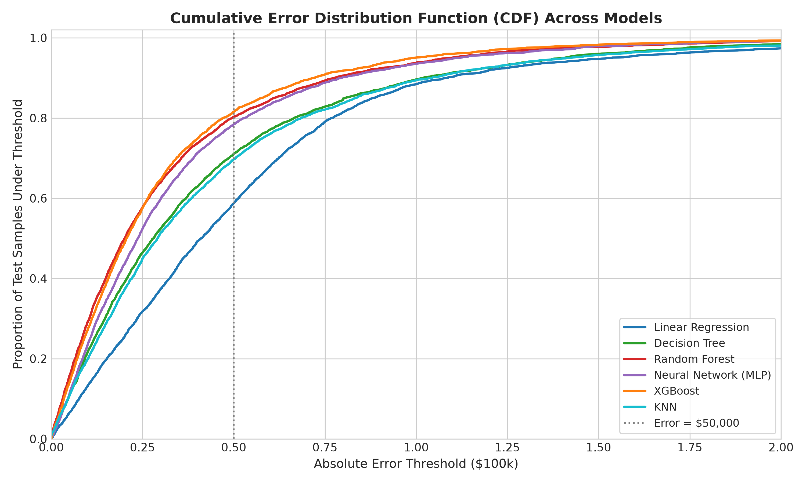

---

## 7. In-Depth Results Analysis

### 7.1 Consistency Across Evaluation Metrics
The empirical findings demonstrate **100% strict consistency across all metrics**:
- **Lowest MAE:** XGBoost (0.3155)
- **Lowest MSE:** XGBoost (0.2273)
- **Lowest RMSE:** XGBoost (0.4767)
- **Highest R² Score:** XGBoost (0.8266)

The ordinal ranking of algorithms remains identical whether evaluated by $L_1$ norm (MAE), $L_2$ norm (MSE/RMSE), or proportional variance explained ($R^2$):
$$\text{XGBoost} \succ \text{Random Forest} \succ \text{Neural Network (MLP)} \succ \text{Decision Tree} \succ \text{KNN} \succ \text{Linear Regression}$$

### 7.2 Why Gradient Boosted Trees and Ensembles Dominated
1. **Non-Linear Geographic Topology:** Housing valuations in California depend critically on geographic coordinates (Latitude and Longitude) interacting with distance to the coastline and metropolitan centers. Linear models cannot capture spatial non-linearities without complex manual polynomial/spline feature expansion.
2. **Second-Order Loss Optimization:** XGBoost computes both first-order gradients ($g_i$) and second-order Hessians ($h_i$) of the squared error loss function, converging faster to sharp local optima compared to simple gradient descent.
3. **Variance Reduction in Random Forest:** The bagging mechanism in Random Forest effectively reduced individual tree variance from RMSE 0.6454 (Decision Tree) down to 0.5060 (Random Forest), an absolute error reduction of $21.6\%$.

### 7.3 Accuracy vs. Interpretability Trade-Off
A core question in applied machine learning is whether the highest-performing model is necessarily the most interpretable:
- **Interpretability:** **Linear Regression** is completely interpretable. Its parameters form a transparent linear equation where each coefficient $\beta_j$ denotes the exact marginal change in house price per unit change in predictor $x_j$, holding all other variables constant. This property is required in regulated credit, mortgage underwriting, and property assessment domains.
- **Accuracy:** In contrast, **XGBoost** and **Random Forest** operate as non-linear ensembles of dozens to hundreds of trees with thousands of split nodes. While global feature importance (e.g., gain, cover) can be computed, the direct decision boundary is a complex piecewise step surface.
- **Conclusion:** The best performing model is **not** the most interpretable. Engineering practitioners must balance the requirement for transparent auditing against the superior predictive accuracy of non-linear ensembles.

---

## 8. Strengths and Limitations Summary

| Algorithm | Computational Complexity | Data Preprocessing Requirements | Interpretability | Outlier / Noise Robustness |
| :--- | :--- | :--- | :--- | :--- |
| **Linear Regression** | Very low ($\mathcal{O}(nd^2)$) | Sensitive to scale and collinearity | High (Closed-form weights) | Poor (Squaring inflates outliers) |
| **Decision Tree** | Low ($\mathcal{O}(n d \log n)$) | Invariant to monotonic scaling | High for shallow depths | Moderate (High variance) |
| **Random Forest** | Medium ($\mathcal{O}(B \cdot n d \log n)$) | Invariant to monotonic scaling | Moderate (Feature importance) | High (Averaging dampens noise) |
| **Neural Network** | High (Multi-epoch gradient descent) | Highly sensitive to scaling | Low (Deep non-linear weights) | Moderate |
| **XGBoost** | Low-Medium (Histogram binning) | Invariant to monotonic scaling | Low (Ensemble tree booster) | High (Shrinkage + $L_1/L_2$ reg) |
| **KNN** | Zero train, High inference ($\mathcal{O}(N_{test} N_{train} d)$) | Extremely sensitive to scaling | Moderate (Local nearest cases) | Poor in high dimensions |

---

## 9. Viva Voce Examination Preparation Guide

For BS Artificial Intelligence students presenting this assignment during viva examination:

1. **Why was `StandardScaler` fit exclusively on `X_train`?**  
   *Answer:* To prevent data leakage. If the scaler computed mean and variance across the full dataset, information about the test distribution would contaminate the training phase, artificially inflating validation performance.
2. **Why do tree-based models not require feature standardization?**  
   *Answer:* Tree-based algorithms split variables independently based on rank order. Because monotonic scaling preserves sample order, split boundaries and impurity reductions remain completely unchanged.
3. **What is the mathematical difference between MAE and RMSE?**  
   *Answer:* MAE penalizes errors linearly ($|y - \hat{y}|$), while RMSE penalizes errors quadratically ($(y - \hat{y})^2$). RMSE gives much higher weight to large errors, making it the preferred metric when severe estimation errors carry disproportionate real-world cost.
4. **Why did KNN exhibit the longest prediction time despite the shortest training time?**  
   *Answer:* KNN is an instance-based lazy learner. It performs zero computation during training (it simply stores the training points). During testing, every test query requires computing pairwise distances to all 16,512 training vectors, yielding $\mathcal{O}(N_{test} \cdot N_{train} \cdot d)$ computational complexity.

---

## 10. How to Run

### Option A: Google Colab (One-Click)
Open the runnable, comment-free notebook directly:  
[](https://colab.research.google.com/github/Afnan-makstrix/comparative-machine-learning-regression/blob/main/comparative_ml_regression_colab.ipynb)

Select **Runtime -> Run all** to execute the pipeline from start to finish.

### Option B: Local Python Execution
1. Clone this repository:
   ```bash
   git clone https://github.com/Afnan-makstrix/comparative-machine-learning-regression.git
   cd comparative-machine-learning-regression
   ```
2. Install dependencies:
   ```bash
   pip install -r requirements.txt
   ```
3. Run the standalone experiment script:
   ```bash
   python experiment.py
   ```
4. All generated figures will be saved in the `figures/` directory, and terminal logs will print the complete comparison table.

---

## 11. Final Academic Conclusion

Under identical experimental conditions on the 20,640 records of the California Housing Dataset:
- **XGBoost (Extreme Gradient Boosting)** achieved the best empirical performance across all metrics with an **RMSE of 0.4767** and an **$R^2$ of 0.8266**, training in just **0.10 seconds**.
- **Random Forest** achieved competitive predictive performance ($R^2 = 0.8046$), but with higher memory and computational overhead.
- **Linear Regression** yielded the lowest predictive accuracy ($R^2 = 0.5758$) due to its inability to model non-linear spatial interactions, but remains the superior model when regulatory compliance and transparent interpretability are required.
